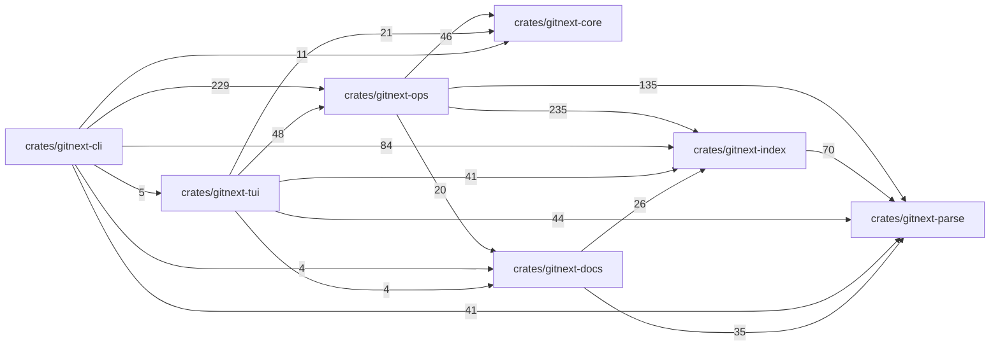

<!-- gitnext:auto:start — generated by `gitnext map`, do not edit by hand -->
# Agent guide: `gitnext`

This repository is indexed by **gitnext**. Don't read or rewrite whole files: navigate with the map and the code graph, read only the symbols you need, edit by symbol.

**Workflow (cheapest first):**

1. `gitnext overview`: languages, areas, entry points, dependencies, activity (once per session).
2. `gitnext map <dir>` → `gitnext outline <file|dir>`: purpose and signatures, no bodies.
3. `gitnext read <Sym> [<Sym>…]`: exact source of just those symbols (`Name@LINE` picks an overload).
4. Edit without reading the file: `gitnext edit replace <Sym>` (new code on stdin), `edit insert-after`, `edit delete`, `gitnext rename <Sym> <new>` (all references). Edits that don't parse are rejected.
5. Before changing a signature: `gitnext impact <Sym>`; then `gitnext tests-for <Sym>` gives the exact test command.
6. Errors / panics / tracebacks: `gitnext locate` (paste on stdin) → the functions at those lines.

**More:** `show <Sym>` · `search <text>` · `callers`/`callees` · `hierarchy <Type>` · `deps <dir>` · `history <Sym>` · `changelog a..b` · `since <rev>` · `diff` · `context "<task>"` · `hotspots` · `dead` · `entrypoints`.

Symbols: `Name`, `Type::method`, `Type.method` or fully qualified. Output is compact text; `--json` for structure. Summaries marked `≈` are inferred (LLM / agent), not written by the authors. With MCP (`gitnext mcp`) all of this are tools; after understanding undocumented code, call `annotate` so the next session gets it for free.

`gitnext commit` refreshes this map and appends a symbol-level change list to the commit message.

## Overview

38 code files (c 2, cpp 1, python 2, rust 33) · 672 functions and types · 92 tests. Reading all of it ≈ 170k tokens.

## Layout

| Directory | Files | Purpose |
|---|---:|---|
| [`crates/`](.gitnext/map/crates/DIR.md) | 49 |  |
| [`crates/gitnext-cli/`](.gitnext/map/crates/gitnext-cli/DIR.md) | 4 | `gitnext` — a git built for AI agents: semantic code map, symbol graph, semantic diffs and a minimal TUI, on top of a 100% git-compatible repo. |
| [`crates/gitnext-cli/src/`](.gitnext/map/crates/gitnext-cli/src/DIR.md) | 3 | `gitnext` — a git built for AI agents: semantic code map, symbol graph, semantic diffs and a minimal TUI, on top of a 100% git-compatible repo. |
| [`crates/gitnext-core/`](.gitnext/map/crates/gitnext-core/DIR.md) | 2 | Git plumbing for gitnext (libgit2 via `git2`). |
| [`crates/gitnext-core/src/`](.gitnext/map/crates/gitnext-core/src/DIR.md) | 1 | Git plumbing for gitnext (libgit2 via `git2`). |
| [`crates/gitnext-docs/`](.gitnext/map/crates/gitnext-docs/DIR.md) | 2 | Markdown map generation: one `DIR.md` per directory under `.gitnext/map/` (mirroring the tree) plus an agent guide block in the root `AGENTS.md`. |
| [`crates/gitnext-docs/src/`](.gitnext/map/crates/gitnext-docs/src/DIR.md) | 1 | Markdown map generation: one `DIR.md` per directory under `.gitnext/map/` (mirroring the tree) plus an agent guide block in the root `AGENTS.md`. |
| [`crates/gitnext-index/`](.gitnext/map/crates/gitnext-index/DIR.md) | 6 | Persistent, incremental code index stored in `.gitnext/index.db` (SQLite). |
| [`crates/gitnext-index/src/`](.gitnext/map/crates/gitnext-index/src/DIR.md) | 4 | Persistent, incremental code index stored in `.gitnext/index.db` (SQLite). |
| [`crates/gitnext-index/tests/`](.gitnext/map/crates/gitnext-index/tests/DIR.md) | 1 | Build output and caches are not indexed even without a .gitignore. |
| [`crates/gitnext-ops/`](.gitnext/map/crates/gitnext-ops/DIR.md) | 15 | High-level workflows shared by the CLI and the TUI: open a workspace, refresh the index, regenerate the map, semantic diff, smart commit, context packs. |
| [`crates/gitnext-ops/src/`](.gitnext/map/crates/gitnext-ops/src/DIR.md) | 13 | High-level workflows shared by the CLI and the TUI: open a workspace, refresh the index, regenerate the map, semantic diff, smart commit, context packs. |
| [`crates/gitnext-ops/tests/`](.gitnext/map/crates/gitnext-ops/tests/DIR.md) | 1 | Regressions from a real agent session on loca (Python): - `rename` missed `__all__`, function-level imports in tests and `module.func` access; - `impact` fol… |
| [`crates/gitnext-parse/`](.gitnext/map/crates/gitnext-parse/DIR.md) | 16 | Language-agnostic code model plus per-language extractors built on tree-sitter. |
| [`crates/gitnext-parse/src/`](.gitnext/map/crates/gitnext-parse/src/DIR.md) | 4 | Language-agnostic code model plus per-language extractors built on tree-sitter. |
| [`crates/gitnext-parse/tests/`](.gitnext/map/crates/gitnext-parse/tests/DIR.md) | 11 | Golden tests for the extractors: every file under `tests/fixtures/` is parsed and rendered as a readable list of symbols and edges, compared with `<file>.exp… |
| [`crates/gitnext-tui/`](.gitnext/map/crates/gitnext-tui/DIR.md) | 4 | Minimal interactive UI: file tree · symbols · detail, with search, staging, commit and semantic diff. |
| [`crates/gitnext-tui/src/`](.gitnext/map/crates/gitnext-tui/src/DIR.md) | 3 | Minimal interactive UI: file tree · symbols · detail, with search, staging, commit and semantic diff. |
| [`docs/`](.gitnext/map/docs/DIR.md) | 9 |  |
| [`docs/images/`](.gitnext/map/docs/images/DIR.md) | 7 |  |
| [`integrations/`](.gitnext/map/integrations/DIR.md) | 5 |  |
| [`integrations/ab/`](.gitnext/map/integrations/ab/DIR.md) | 3 |  |
| [`integrations/loca/`](.gitnext/map/integrations/loca/DIR.md) | 2 | Eval: does gitnext help a small local agent? Runs loca's own benchmark (bench/run.py) in several modes and compares pass rate, steps and tokens. |
| [`scripts/`](.gitnext/map/scripts/DIR.md) | 1 |  |

## Architecture (area → area, number of references)

## Key symbols (most referenced across files)

- `Graph` struct in `crates/gitnext-index/src/graph.rs` · 83 refs
- `short_name` method in `crates/gitnext-index/src/graph.rs` — Shortest `::`-suffix of the qualified name that identifies this symbol uniquely (overloads share a name). · 38 refs
- `find` method in `crates/gitnext-index/src/graph.rs` — Find symbols by exact qualified name, `::`-suffix, or bare name. · 37 refs
- `collapse` function in `crates/gitnext-parse/src/rust.rs` · 30 refs
- `open` method in `crates/gitnext-ops/src/lib.rs` — Discover the git repository around `cwd`; fall back to `cwd` itself so read-only commands (map, symbols…) work in any folder. · 28 refs
- `is_type` method in `crates/gitnext-parse/src/lib.rs` · 28 refs
- `dir_of` function in `crates/gitnext-index/src/lib.rs` — Directory part of a slash path ("" for the root). · 23 refs
- `is_callable` method in `crates/gitnext-parse/src/lib.rs` · 22 refs
- `Edge` struct in `crates/gitnext-parse/src/lib.rs` — A directed, *unresolved* reference: `to` is the name as written in source. · 20 refs
- `repo` method in `crates/gitnext-ops/src/lib.rs` · 17 refs
- `json` method in `crates/gitnext-cli/src/main.rs` · 16 refs
- `Repo` struct in `crates/gitnext-core/src/lib.rs` · 16 refs
- `is_public` method in `crates/gitnext-parse/src/lib.rs` · 16 refs
- `Workspace` struct in `crates/gitnext-ops/src/lib.rs` · 15 refs
- `Symbol` struct in `crates/gitnext-parse/src/lib.rs` · 15 refs
<!-- gitnext:auto:end -->
