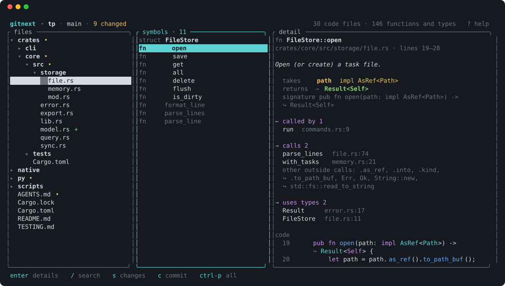
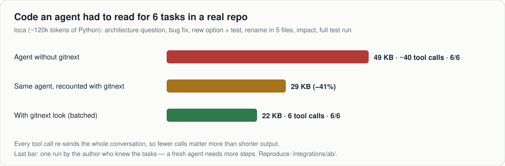
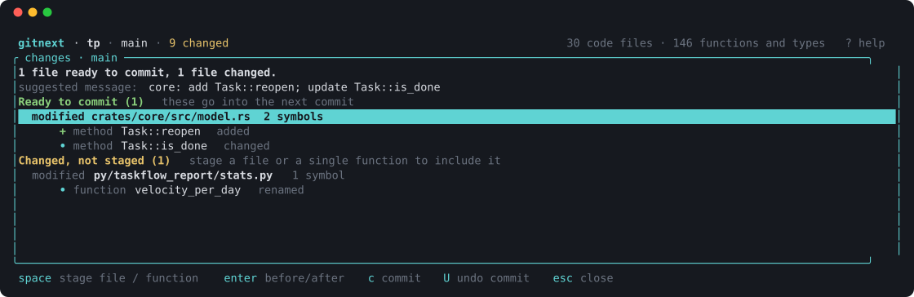
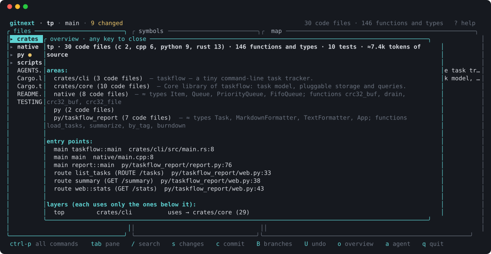
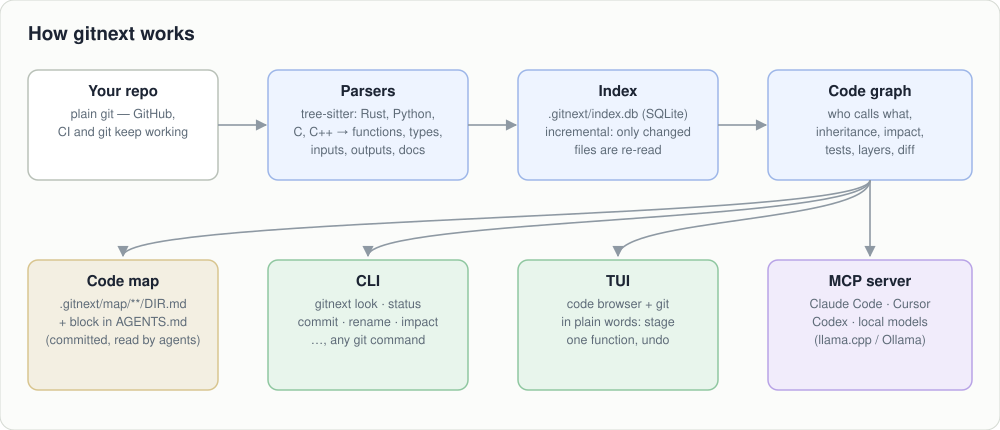

<h1 align="center">gitnext</h1>

<p align="center">
  <b>git that understands your code — for AI agents and the people who review them</b><br>
  <a href="README.ru.md">Русский</a> · <a href="docs/GUIDE.ru.md">Full guide (RU)</a> · <a href="docs/AGENT_INSTALL.md">Install guide for agents</a>
</p>

<p align="center">
  <a href="https://github.com/pnnnx/gitnext/actions/workflows/ci.yml"></a>
  <a href="LICENSE"></a>
  
</p>

<p align="center"></p>

gitnext is a drop-in companion to git (`gitnext` = `git` + a code index). It parses Rust, Python, C, C++, TypeScript, JavaScript, Go and Java into functions, types and the calls between them, knows which libraries each function calls (with the versions from `package.json`, `go.mod`, `pom.xml`, `Cargo.toml`, `pyproject.toml`), and puts that graph to work:

- **agents** read one function instead of a whole file, see who calls it and which tests cover it in **one call**, and rename or edit by symbol;
- **people** browse code as a map, see changes as "function X changed" instead of line noise, stage a single function and undo a commit without fear.

The repository stays plain git — GitHub, CI and your other tools keep working.

## Measured on a real repository

<p align="center"></p>

Most of an agent session is the system prompt re-sent on every step, so the win comes from **fewer steps**, not just shorter output: `gitnext look A B C` answers *what is it · who calls it · what it calls · which tests reach it and how to run them · what a change affects* for several targets at once. Small local models (4B) did not use the tools at all — for them the compact code map in `AGENTS.md` is what helps. Details and how to reproduce: [docs/GUIDE.ru.md](docs/GUIDE.ru.md), [integrations/ab](integrations/ab).

## Install

```sh
git clone https://github.com/pnnnx/gitnext && cd gitnext
sh scripts/install.sh          # builds from source (needs Rust: https://rustup.rs)
# or, once a release is published:
curl -fsSL https://raw.githubusercontent.com/pnnnx/gitnext/main/scripts/install.sh | sh
```

## Quick start

```sh
cd your-project
gitnext init        # index the code, write the map (.gitnext/map, AGENTS.md)
gitnext setup       # connect Claude Code / Cursor / Codex / loca
gitnext doctor      # check that everything is in place
gitnext             # open the TUI
```

## For agents

| Need | Command (CLI) / MCP tool |
|---|---|
| everything about a symbol, several at once | `gitnext look Agent.execute brief config.py` / `look` |
| skeleton of a file or folder | `gitnext outline <path>` / `outline` |
| edit one function without reading the file | `gitnext edit replace <Sym> -f new.py` / `replace_symbol` |
| rename everywhere (imports, tests, `__all__`, `mod.func`) | `gitnext rename <old> <new>` / `rename_symbol` |
| what breaks, which tests to run | `gitnext impact <Sym>` · `gitnext tests-for <Sym>` (the 10 most likely to fail + one command for the rest) |
| which tests really run a function (Python) | `gitnext learn-tests` — one pytest run with coverage; `tests-for`, `look` and `check` then use the real list (on click: 100% of the failing tests found instead of 19%) |
| did my change break anything | `gitnext check` — builds and runs the tests of what changed, prints a verdict (`gitnext rename A B --check` does it right after the rename) |
| error or traceback → code | `gitnext locate` (stdin) / `locate` |
| where were we | `gitnext brief` · `gitnext journal` |
| which libraries the code calls, with versions | `gitnext libs` (and `look` shows them per function) |

`gitnext setup` writes the MCP config and a short instruction block for each agent; `--hooks` makes Claude Code see an outline before reading a big file whole.

## Git in plain words

<p align="center"></p>

```sh
gitnext status            # what changed, by function, with a suggested commit message
gitnext add Task::reopen  # stage just this function
gitnext commit            # offers the message; the symbol list goes into the commit
gitnext undo              # take the last commit back, changes stay staged
gitnext timeline          # every earlier point of the branch; --to N goes back
gitnext branches          # how far ahead/behind each branch is and what it changes
```

In the TUI: `s` changes, `space` stages a file or one function, `enter` shows before/after side by side, `c` commit, `U` undo, `H` time machine, `B` branches, `ctrl-p` every action.

<p align="center"></p>
<p align="center"><sub>Overview (<code>o</code>): languages and size, areas and their purpose, entry points (main, HTTP routes, CLI), dependency layers — foundation at the bottom, its users on top.</sub></p>

## How it works

<p align="center"></p>

| Folder | What it does |
|---|---|
| `crates/gitnext-parse` | tree-sitter parsers → symbols (kind, signature, inputs, output, docs) and references. Rust, Python, C, C++ have their own extractors; TypeScript, JavaScript, Go and Java go through one table-driven engine (`generic.rs` + a table per language in `specs.rs`) |
| `crates/gitnext-index` | incremental SQLite index, code graph (callers, impact, inheritance, layers), semantic diff |
| `crates/gitnext-core` | git plumbing on libgit2: status, commit, stage by line range, undo, branches, reflog |
| `crates/gitnext-docs` | the map: `.gitnext/map/**/DIR.md` and the block in `AGENTS.md` |
| `crates/gitnext-ops` | features: `look`, edits and rename, changes in words, history, insight, agent setup, explain, LSP |
| `crates/gitnext-cli` | the `gitnext` command and the MCP server |
| `crates/gitnext-tui` | the terminal UI |
| `integrations/` | A/B test kit for real agents, loca (llama.cpp) benchmark |

## Status

Early but used daily on its own code (this repository is indexed by gitnext — see `AGENTS.md`). Name-based resolution is approximate for dynamic code; `gitnext lsp` refines it with rust-analyzer / pyright / clangd. Parser output is pinned by fixtures in `crates/gitnext-parse/tests/fixtures`.

## Similar projects

Each piece exists elsewhere; gitnext puts them in one tool and measures the effect.

| Project | What it does | How gitnext differs |
|---|---|---|
| [Aider repo map](https://aider.chat/docs/repomap.html) | tree-sitter map of the repo in the prompt | the map is committed to the repo (`AGENTS.md`, `.gitnext/map`), so any agent — even a small local model without tools — gets it |
| [Serena](https://oraios.github.io/serena/01-about/035_tools.html) | MCP tools to find, edit and rename by symbol, via language servers | one call `look` returns code + callers + callees + tests + impact; works without a language server (LSP is optional refinement) |
| [CodeGraph](https://colbymchenry.github.io/codegraph/), [CodeGraphContext](https://mcpservers.org/servers/shashankss1205/codegraphcontext) | code graph over MCP: callers, callees, impact | also injects the code a task needs before the request (`gitnext context`) for agents that do not call tools |
| [sem](https://docs.rs/sem-cli/0.7.0/sem/) | entity-level diff, blame and impact on top of git | adds plain-language git: stage or commit one function, undo, timeline, commit message from changed functions |
| [lazygit](https://github.com/jesseduffield/lazygit), [GitButler](https://gitbutler.com) | friendly git UIs | the TUI shows code by function and relation, not only files and hunks |

What we can show that others do not: savings measured on a real agent and a real repository ([integrations/ab](integrations/ab), [integrations/loca](integrations/loca)).

## License

MIT — see [LICENSE](LICENSE).
