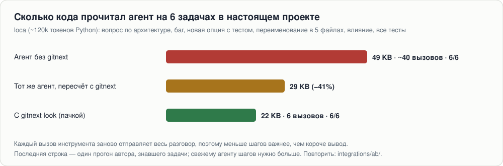
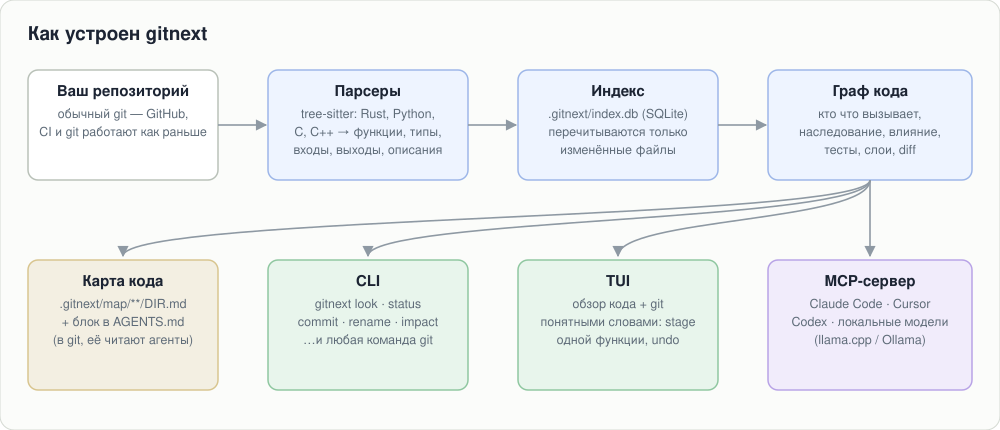

<h1 align="center">gitnext</h1>

<p align="center">
  <b>git, который понимает код, — для ИИ-агентов и людей, которые за ними проверяют</b><br>
  <a href="README.md">English</a> · <a href="docs/GUIDE.ru.md">Полное руководство</a> · <a href="docs/AGENT_INSTALL.md">Инструкция по установке для агента</a>
</p>

<p align="center">
  <a href="https://github.com/pnnnx/gitnext/actions/workflows/ci.yml"></a>
  <a href="LICENSE"></a>
  
</p>

<p align="center"></p>
<p align="center"><sub>Слева — файлы, в середине — функции и типы файла, справа — выбранная функция: что принимает (<code>takes</code>), что возвращает (<code>returns →</code>), кто её вызывает (<code>← called by</code>), что вызывает она (<code>→ calls</code>) и её код.</sub></p>

gitnext — спутник git (`gitnext` = `git` + индекс кода). Он разбирает Rust, Python, C, C++, TypeScript, JavaScript, Go и Java на функции, типы и связи между ними, знает, какие библиотеки вызывает каждая функция (с версиями из `package.json`, `go.mod`, `pom.xml`, `Cargo.toml`, `pyproject.toml`), и использует этот граф:

- **агенту** — прочитать одну функцию вместо файла, за **один вызов** узнать, кто её вызывает и какие тесты её проверяют, переименовать или поправить по имени символа;
- **человеку** — смотреть на код как на карту, видеть изменения как «поменялась функция X», застейджить одну функцию и спокойно отменить коммит.

Репозиторий остаётся обычным git: GitHub, CI и остальные инструменты работают как раньше.

## Замер на настоящем проекте

<p align="center"></p>

Большую часть сессии агента съедают системные инструкции, которые отправляются заново на каждом шаге. Поэтому выигрыш даёт **меньшее число шагов**, а не только более короткий вывод: `gitnext look A B C` сразу для нескольких целей отвечает *что это · кто вызывает · что вызывает · какие тесты и как их запустить · что заденет изменение*. Маленькие локальные модели (4B) инструментами не пользовались вовсе — им помогает компактная карта кода в `AGENTS.md`. Подробности и как повторить: [docs/GUIDE.ru.md](docs/GUIDE.ru.md), [integrations/ab](integrations/ab).

## Установка

```sh
git clone https://github.com/pnnnx/gitnext && cd gitnext
sh scripts/install.sh          # сборка из исходников (нужен Rust: https://rustup.rs)
# или, когда выйдет релиз:
curl -fsSL https://raw.githubusercontent.com/pnnnx/gitnext/main/scripts/install.sh | sh
```

## Быстрый старт

```sh
cd ваш-проект
gitnext init        # индекс кода и карта (.gitnext/map, AGENTS.md)
gitnext setup       # подключить Claude Code / Cursor / Codex / loca
gitnext doctor      # проверить, что всё на месте
gitnext             # открыть TUI
```

## Для агента

| Задача | Команда (CLI) / инструмент MCP |
|---|---|
| всё о символе, сразу о нескольких | `gitnext look Agent.execute brief config.py` / `look` |
| скелет файла или папки | `gitnext outline <путь>` / `outline` |
| поправить функцию, не читая файл | `gitnext edit replace <Sym> -f new.py` / `replace_symbol` |
| переименовать везде (импорты, тесты, `__all__`, `mod.func`) | `gitnext rename <старое> <новое>` / `rename_symbol` |
| что сломается и какие тесты гонять | `gitnext impact <Sym>` · `gitnext tests-for <Sym>` |
| ошибка или traceback → код | `gitnext locate` (stdin) / `locate` |
| на чём остановились | `gitnext brief` · `gitnext journal` |
| какие библиотеки и версии использует код | `gitnext libs` (а `look` показывает их у каждой функции) |

`gitnext setup` пишет конфиг MCP и короткий блок инструкций для каждого агента; с `--hooks` Claude Code сначала видит скелет большого файла, а не читает его целиком.

## Git понятными словами

<p align="center"></p>
<p align="center"><sub>Экран изменений: группы «готово к коммиту» и «изменено, не застейджено», под каждым файлом — изменённые функции. Здесь застейджена одна функция <code>Task::reopen</code>, сообщение коммита предложено по изменениям.</sub></p>

```sh
gitnext status            # что изменилось — по функциям, с предложенным сообщением коммита
gitnext add Task::reopen  # застейджить одну функцию
gitnext commit            # предложит сообщение; список изменённых функций попадёт в коммит
gitnext undo              # забрать последний коммит, изменения останутся застейдженными
gitnext timeline          # все прошлые точки ветки; --to N — вернуться
gitnext branches          # насколько ветки впереди/позади и что они меняют
```

В TUI: `s` — изменения, `space` — застейджить файл или одну функцию, `enter` — «было / стало» рядом, `c` — коммит, `U` — отмена коммита, `H` — машина времени, `B` — ветки, `ctrl-p` — все действия.

<p align="center"></p>
<p align="center"><sub>Обзор (<code>o</code>): языки и размер, области с назначением, точки входа (main, HTTP-маршруты, CLI), слои зависимостей — снизу фундамент, сверху то, что им пользуется.</sub></p>

## Как устроено

<p align="center"></p>

**Что за что отвечает**

| Где | За что отвечает |
|---|---|
| `crates/gitnext-parse` | разбор кода (tree-sitter) → символы (вид, сигнатура, входы, выход, описание) и ссылки между ними. У Rust, Python, C, C++ свои разборщики; TypeScript, JavaScript, Go и Java идут через один общий движок (`generic.rs` + таблица на язык в `specs.rs`) — новый язык добавляется таблицей |
| `crates/gitnext-index` | индекс в SQLite (перечитывает только изменённые файлы), граф кода: кто кого вызывает, влияние, наследование, слои; diff по функциям |
| `crates/gitnext-core` | работа с git через libgit2: статус, коммит, stage по диапазону строк, отмена коммита, ветки, reflog |
| `crates/gitnext-docs` | карта кода: `.gitnext/map/**/DIR.md` и блок в `AGENTS.md` |
| `crates/gitnext-ops` | возможности поверх графа (по файлам ниже) |
| `crates/gitnext-cli` | команда `gitnext` (`main.rs`, `cmds.rs`) и MCP-сервер (`mcp.rs`) |
| `crates/gitnext-tui` | терминальный интерфейс: панели и навигация (`lib.rs`), git словами (`git.rs`), понятные описания папок и функций (`views.rs`) |
| `integrations/ab` | A/B-тест на настоящем агенте: две копии проекта, промпт, проверка |
| `integrations/loca` | бенчмарк с локальной моделью через loca (llama.cpp / Ollama) |
| `scripts/install.sh`, `.github/workflows` | установка, CI (clippy + тесты на Ubuntu и macOS), релизы по тегу |

Внутри `crates/gitnext-ops/src`:

| Файл | За что отвечает |
|---|---|
| `look.rs` | `look`: один вызов — код, вызовы, тесты, влияние; файл, папка, ошибка, слова |
| `edit.rs` | правка символа (`replace`, `insert-after`, `delete`) с проверкой синтаксиса; `rename` |
| `changes.rs` | изменения словами, stage одной функции, черновик сообщения коммита, «было / стало», понятные ошибки git |
| `agents.rs` | `setup` для агентов, инструкции для них, `brief`, хуки Claude Code, `doctor` |
| `render.rs` | текстовые ответы: outline, show, callers, impact, hierarchy… |
| `locate.rs` | ошибка → код; какие тесты проверяют символ и как их запустить |
| `history.rs` | история символа по коммитам, семантический changelog |
| `insight.rs` | обзор, активность, горячие точки, мёртвый код, циклы, точки входа |
| `explain.rs` | однострочные описания кода без документации через LLM (в т.ч. локальную) |
| `lsp.rs` | уточнение графа через rust-analyzer / pyright / clangd |
| `journal.rs` | журнал агента: что читал, что правил, сколько сэкономил |
| `bench.rs` | замер экономии на репозитории |
| `libs.rs` | библиотеки словами: что функция вызывает снаружи — по пакетам, с версиями из манифестов; весь стек проекта |
| `context.rs` | подбор кода под задачу одним куском — для локальных моделей (хук `before_prompt` в loca) |

## Состояние

Рабочий ранний вариант; этот репозиторий сам проиндексирован gitnext (см. `AGENTS.md`). Связи по именам для динамического кода приблизительны — `gitnext lsp` уточняет их языковыми серверами. Результат парсеров закреплён эталонами в `crates/gitnext-parse/tests/fixtures`.

## Лицензия

MIT — см. [LICENSE](LICENSE).
